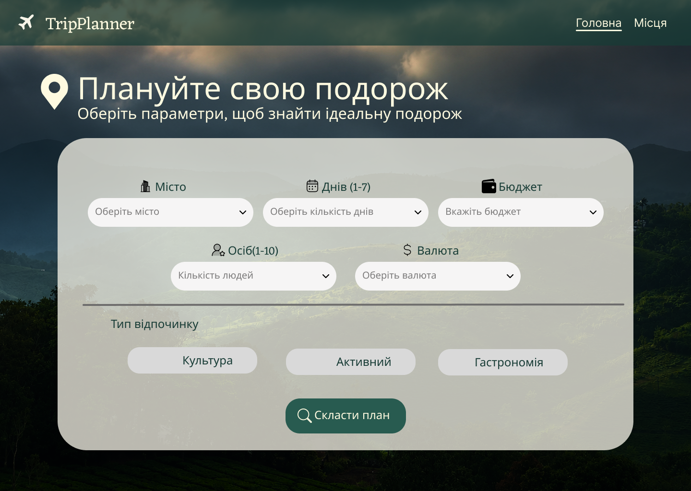

# TravelPlaner2026

## Мета
## Аналог
## Команда й ролі
## Джерела
## Як запустити

## Дизайн
Макет у Figma: [відкрити](https://www.figma.com/design/KUgWSii5S6JltMgoFQIHXG/TripPlanner?node-id=9-2&t=nuIIoGqQ25qp3RBG-1)
### Головна

### План
## Запуск тестів

## Запуск тестів

**Що потрібно:** [Node.js](https://nodejs.org) версії 18 або новішої. Додаткових пакетів встановлювати не треба.

**Команда** (з кореня проєкту, де лежить `package.json`):

```bash
npm test
```

Усі тести з папки `tests/` запускаються однією командою. Успішний запуск закінчується рядками `# fail 0` і кодом завершення 0.

**Де що лежить:**
- `js/calculateCost.js` — функція розрахунку вартості;
- `js/data.js` — дані (міста, місця, ціни в EUR);
- `tests/calculateCost.test.js` — 3 основні тести для `calculateCost` (бюджету вистачає, не вистачає, некоректні дані);
- `tests/test.js` — розширений набір: перевірка даних, приклади з документації, валідація, фільтрація за типом.

**Якщо щось не працює:**
- `npm: command not found` — встановіть Node.js і перезапустіть термінал;
- переконайтеся, що термінал відкрито в папці проєкту (у рядку має бути `...\TravelPlaner2026>`);
- версію Node перевіряє `node -v`.